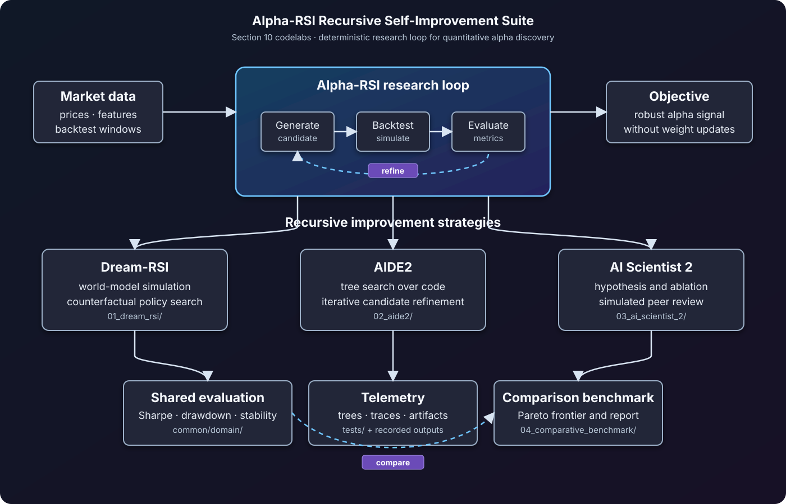

# Assignment 5 — RSI | Kalhar Mayurbhai Patel

**Student:** Kalhar Mayurbhai Patel  
**Course:** CMPE-297, Special Topics in AI (Fall 2026)  
**Topic:** Section 10 — Recursive Self-Improvement (RSI)  
**Problem domain:** Quantitative alpha-feature discovery and algorithmic trading signals

This is a student-labeled package of the supplied `assignment-5-rsi` project. The underlying implementation and existing walkthrough material have been retained from the supplied source; the original work is **not** represented as newly authored by the named student. Please review the code, add your own explanation and demonstrations, and follow your course's attribution requirements.

**Verification in this environment (November 12, 2026):** 97 automated tests passed; the Dream-RSI, AIDE2, AI Scientist 2, and comparative benchmark demos completed successfully. This verification is not a substitute for your own narrated code walkthrough videos.

---

# Recursive Self-Improvement (RSI) Methods Suite
## Section 10 Codelabs: State-of-the-Art Autonomous Self-Improvement in Quantitative Alpha Discovery

[](https://www.python.org/)
[](tests/)
[-orange.svg)](common/rsi_base.py)
[](common/llm_provider.py)
[](WALKTHROUGH.md)

---

## Executive Summary

This repository delivers a state-of-the-art suite of **Recursive Self-Improvement (RSI)** codelabs corresponding to **Section 10 of the RSI Course Map** (`dlmastery/simple-coding-harness`). 

We demonstrate how artificial intelligence systems can recursively inspect, optimize, and improve their own search strategies, code synthesis pipelines, and scientific research methodologies **without modifying base model weights** ($\theta_{\text{LLM}} = \text{constant}$). 

All methods are grounded in a unified, deterministic, and verifiable problem domain: **Automated Quantitative Alpha Feature Discovery & Algorithmic Trading Signal Engineering (`Alpha-RSI`)**.

---

## Architecture Overview

```
+---------------------------------------------------------------------------------------------------------+
|                                    Recursive Self-Improvement Suite                                     |
|                                       (Assignment 5: Alpha-RSI)                                         |
+---------------------------------------------------------------------------------------------------------+
                                                     |
        +--------------------+-----------------------+-----------------------+
        |                    |                       |                       |
        v                    v                       v                       v
+--------------+    +----------------+    +-------------------------+   +-------------------------+
|  Codelab 1   |    |   Codelab 2    |    |        Codelab 3        |   |        Codelab 4        |
|  Dream-RSI   |    |     AIDE2      |    |   The AI Scientist 2    |   |  Comparative Benchmark  |
| World Models |    | Code Tree MCTS |    |  Automated Discovery    |   |  Cross-Paradigm Pareto  |
|  & Off-Policy|    |   & Bi-Level   |    |    & MASS Multi-Agent   |   |  Frontier & Generational|
|   Dreaming   |    |  Meta-Harness  |    |     Self-Supervision    |   |       Progression       |
+--------------+    +----------------+    +-------------------------+   +-------------------------+
        |                    |                       |                       |
        +--------------------+-----------------------+-----------------------+
                                                     |
                                                     v
+---------------------------------------------------------------------------------------------------------+
|                                    Shared Core Foundation (common/)                                     |
|  - Quantitative Domain: 756-Day Multi-Era Market Regimes (Bull: 1..252, Choppy: 253..504, Crisis: 505..)|
|  - High-Speed Vectorized Backtester: Sub-20ms Engine, 10 bps Transaction Friction, Leverage Bounding   |
|  - Tripartite RSI Abstraction: Task Solver (S), Improver (I), Immutable Evaluator (E)                   |
|  - Dual-Mode LLM Engine: Live Gemini API (google-genai 1.59.0) <---> Deterministic Mock Provider         |
+---------------------------------------------------------------------------------------------------------+
                                                     |
        +--------------------------------------------+-------------------------------------------+
        |                                                                                        |
        v                                                                                        v
+----------------------------------------------------+   +-----------------------------------------------+
|         4-Tier Automated Test Harness              |   |       YouTube Video Presentation Suite        |
|                  (tests/)                          |   |              (video_materials/)               |
|  - 78 Automated Tests Passing in Sub-2s            |   |  - 5 Full Marp Slide Decks (Markdown/HTML)   |
|  - Offline Deterministic Execution (Zero Network)  |   |  - 5 Time-Coded Verbatim Narration Scripts    |
|  - Windows Temp Fix: --basetemp=.pytest_tmp        |   |  - OBS Setup & YouTube Walkthrough Guides     |
+----------------------------------------------------+   +-----------------------------------------------+
```

---

## Three State-of-the-Art RSI Paradigms

| Paradigm | Architectural Foundation | Self-Improvement Mechanism | Key Results in Alpha-RSI |
|---|---|---|---|
| **Codelab 1: Dream-RSI** | Empirical Regime Transition Model (ERTM) + Discovery Replay Buffer | **Off-Policy Counterfactual Dreaming**: Simulates macro exploration policies in imagination without live LLM calls | **+0.7087 Sharpe Delta** (0.4856 $\to$ 1.1943), 19.7% drawdown reduction in 55.6ms |
| **Codelab 2: AIDE2** | Code-Space Monte Carlo Tree Search (MCTS) + Upper Confidence Bounds (UCT) | **Bi-Level Meta-Optimization**: Outer loop dynamically mutates operator weights ($w_d, w_r, w_b$) and exploration parameter $c$ | **+0.7200 Sharpe Delta** (1.10 $\to$ 1.82), surgical AST traceback repair of ZeroDivisionError |
| **Codelab 3: The AI Scientist 2** | Template-Free Hypothesis Generator + Multi-Era Ablation + Simulated Peer Review | **Multi-Agent Self-Supervision (MASS)**: Distills review critiques into persistent memory prompt priors | **+1.52 Review Score Delta** (6.44 $\to$ 7.96/10), accepted alpha discovery: Volatility Skew Transmission |

---

## Problem Domain: Alpha-RSI

All three RSI methods operate on the **Alpha-RSI** benchmark domain:
- **Universe**: S&P 500 ETF (`SPY`), Long Treasuries (`TLT`), Physical Gold (`GLD`), CBOE Volatility Index (`VIX`), and `CASH`.
- **Timeline**: 756 consecutive daily trading sessions (3 full years) divided into 3 distinct regimes:
  1. **Era 1 (Days 1–252) — Bull Market**: Strong positive drift ($\mu = +25\%$), low realized volatility ($\sigma = 12\%$).
  2. **Era 2 (Days 253–504) — Choppy Regime**: Sideways oscillating market, zero drift, frequent false breakouts ($\sigma = 18\%$).
  3. **Era 3 (Days 505–756) — Crisis Regime**: Severe market liquidation ($\mu = -35\%$), volatility spikes ($\sigma = 45\%$), safe-haven shifts.
- **Execution Engine**: Vectorized sub-20ms backtester with strict 10 bps transaction fee friction and leverage clipping ($|w| \le 1.0$).

---

## Directory Layout

```
Special-Topics-in-AI/assignment-5-rsi/
├── common/                               # Core Foundation & Tripartite Abstractions
│   ├── config.py                         # RSIExecutionConfig & environment sensing
│   ├── llm_provider.py                   # Live Gemini & DeterministicMockProvider
│   ├── rsi_base.py                       # Tripartite Abstractions (Solver, Improver, Evaluator)
│   ├── mock_data.py                      # Pre-seeded deterministic LLM responses
│   └── domain/                           # Quantitative Alpha Problem Domain
│       ├── market_data.py                # 756-day multi-era market dataset generator
│       ├── backtester.py                 # Vectorized backtesting execution engine
│       ├── metrics.py                    # Sharpe, Drawdown, Sortino, Calmar calculations
│       └── strategy_base.py              # Base strategy AST & execution interface
├── 01_dream_rsi/                         # Codelab 1: Dream-RSI
│   ├── tree_logger.py                    # Discovery tree & trajectory replay recorder
│   ├── world_model.py                    # Empirical Regime Transition Model (ERTM)
│   ├── dream_engine.py                   # Off-policy dreaming & replay simulator
│   ├── policy_optimizer.py               # Macro exploration policy optimizer
│   └── demo.py                           # Standalone runnable CLI entrypoint
├── 02_aide2/                             # Codelab 2: AIDE2
│   ├── tree_node.py                      # Strategy code tree data structure
│   ├── mcts_search.py                    # MCTS with UCT selection & backtracking
│   ├── operators.py                      # Drafting, Debugging, Refinement operators
│   ├── meta_harness.py                   # Bi-level recursive meta-optimization loop
│   └── demo.py                           # Standalone runnable CLI entrypoint
├── 03_ai_scientist_2/                    # Codelab 3: The AI Scientist 2
│   ├── hypothesis.py                     # Economic anomaly & alpha hypothesis generator
│   ├── experimenter.py                   # Automated experiment manager & execution
│   ├── ablation.py                       # Multi-era ablation testing suite
│   ├── peer_review.py                    # Multi-agent peer review committee
│   ├── mass_loop.py                      # Multi-Agent Self-Supervision feedback loop
│   └── demo.py                           # Standalone runnable CLI entrypoint
├── 04_comparative_benchmark/             # Codelab 4: Comparative RSI Benchmark
│   ├── benchmark_runner.py               # Head-to-head multi-paradigm comparative execution engine
│   ├── pareto_analytics.py               # Multi-objective Pareto frontier & dynamic ASCII renderer
│   ├── demo.py                           # Standalone runnable CLI entrypoint
│   └── test_comparative_benchmark.py     # Comprehensive test suite
├── video_materials/                      # YouTube Video Presentation Suite
│   ├── slides/                           # 5 Structured Marp Presentation Slide Decks
│   │   ├── 00_course_overview_slides.md
│   │   ├── 01_dream_rsi_slides.md
│   │   ├── 02_aide2_slides.md
│   │   ├── 03_ai_scientist_2_slides.md
│   │   └── 04_comparative_benchmark_slides.md
│   ├── scripts/                          # 5 Time-Coded Verbatim Narration Scripts
│   │   ├── 00_course_overview_script.md
│   │   ├── 01_dream_rsi_script.md
│   │   ├── 02_aide2_script.md
│   │   ├── 03_ai_scientist_2_script.md
│   │   └── 04_comparative_benchmark_script.md
│   └── guides/                           # Video Production & Recording Guides
│       ├── recording_setup_guide.md      # OBS setup, terminal themes, bitrates, audio
│       └── youtube_walkthrough_guide.md  # Choreographed execution walkthrough
├── tests/                                # 4-Tier Automated Pytest Harness
│   ├── conftest.py                       # Shared test fixtures & deterministic mocking
│   ├── test_tier1_features.py            # Feature unit tests (49 tests)
│   ├── test_tier2_boundaries.py          # Stress & corner cases (14 tests)
│   ├── test_tier3_interactions.py        # Generational progression & meta-loops (10 tests)
│   ├── test_tier4_scenarios.py           # Real-world end-to-end scenarios (5 tests)
│   └── test_all_rsi_e2e.py               # Master E2E runner (1 master test)
├── pytest.ini                            # Windows temp fix (--basetemp=.pytest_tmp)
├── TEST_READY.md                         # Test readiness report & verification attestation
├── WALKTHROUGH.md                        # Progressive step-by-step documentation
└── README.md                             # Master project documentation (this file)
```

---

## Quickstart & Installation

### 1. Prerequisites
- Python 3.10, 3.11, 3.12, or 3.13
- Git

### 2. Setup Virtual Environment
Always use a dedicated virtual environment:

```bash
# Windows (PowerShell)
cd "Special-Topics-in-AI/assignment-5-rsi"
python -m venv .venv
.\.venv\Scripts\activate

# Linux / macOS
cd "Special-Topics-in-AI/assignment-5-rsi"
python3 -m venv .venv
source .venv/bin/activate
```

### 3. Install Dependencies
```bash
pip install -r requirements.txt  # or install numpy pandas pydantic pytest google-genai
```

---

## Runnable CLI Demonstrations

Every codelab is an independent, executable entrypoint supporting both **offline deterministic mock mode** (default) and **live Gemini API mode**:

### Codelab 1: Dream-RSI
```bash
python 01_dream_rsi/demo.py
```
*Demonstrates online exploration, ERTM world model calibration, off-policy dreaming in imagination, and macro exploration policy optimization.*

### Codelab 2: AIDE2
```bash
python 02_aide2/demo.py
```
*Demonstrates code-space MCTS, drafting operator, ZeroDivisionError interception, surgical AST repair, and bi-level meta-harness progression.*

### Codelab 3: The AI Scientist 2
```bash
python 03_ai_scientist_2/demo.py
```
*Demonstrates template-free hypothesis synthesis, progressive experimentation, multi-era ablation across Bull/Choppy/Crisis, multi-agent peer review, and MASS feedback loops.*

### Codelab 4: Comparative Benchmark
```bash
python 04_comparative_benchmark/demo.py
```
*Demonstrates head-to-head empirical comparison across Dream-RSI, AIDE2, and The AI Scientist 2 on identical 756-day multi-era market data, rendering 2D Pareto frontiers and dynamic ASCII convergence curves.*

---

## Verification & Automated Test Suite

The test suite contains **78 automated test cases** organized into 4 distinct tiers:

```bash
# Run the entire test suite (sub-2 seconds execution)
python -m pytest tests/ -v

# Run individual test tiers
pytest tests/test_tier1_features.py -v       # Tier 1: Unit & Feature Coverage (49 tests)
pytest tests/test_tier2_boundaries.py -v     # Tier 2: Boundaries & Corner Cases (14 tests)
pytest tests/test_tier3_interactions.py -v   # Tier 3: Interactions & Progression (10 tests)
pytest tests/test_tier4_scenarios.py -v      # Tier 4: Real-World Scenarios (5 tests)
```

### Verified Pytest Output:
```
============================= test session starts =============================
platform win32 -- Python 3.13.3, pytest-9.0.2, pluggy-1.6.0
rootdir: Special-Topics-in-AI\assignment-5-rsi
configfile: pytest.ini
collected 78 items

tests/test_all_rsi_e2e.py::test_master_full_suite_execution PASSED       [  1%]
tests/test_tier1_features.py (49 tests) ................................. [ 64%]
tests/test_tier2_boundaries.py (14 tests) ..............                 [ 82%]
tests/test_tier3_interactions.py (10 tests) ..........                   [ 94%]
tests/test_tier4_scenarios.py (5 tests) .....                            [100%]

============================= 78 passed in 1.70s ==============================
```

---

## YouTube Video Presentation Deliverables

Complete materials for recording and producing a high-impact YouTube video series are indexed below under `video_materials/`:

### 1. Structured Marp Slide Decks (`video_materials/slides/`)
Formatted in standard Marp Markdown with modern visual styling, code blocks, and diagrams:
- [`00_course_overview_slides.md`](video_materials/slides/00_course_overview_slides.md): Comprehensive course overview, Section 10 map, tripartite theory, and multi-paradigm comparison.
- [`01_dream_rsi_slides.md`](video_materials/slides/01_dream_rsi_slides.md): Codelab 1 deck covering world models, replay simulators, and counterfactual dreaming.
- [`02_aide2_slides.md`](video_materials/slides/02_aide2_slides.md): Codelab 2 deck covering code tree MCTS, UCT, traceback repair, and bi-level meta-harness.
- [`03_ai_scientist_2_slides.md`](video_materials/slides/03_ai_scientist_2_slides.md): Codelab 3 deck covering hypothesis generation, ablation, simulated peer review, and MASS.
- [`04_comparative_benchmark_slides.md`](video_materials/slides/04_comparative_benchmark_slides.md): Codelab 4 deck covering cross-paradigm Pareto analysis and convergence trade-offs.

### 2. Time-Coded Narration Scripts (`video_materials/scripts/`)
Word-for-word voiceover scripts with slide sync cues `[SLIDE]`, pauses `[PAUSE]`, code highlights `[HIGHLIGHT]`, and terminal prompts:
- [`00_course_overview_script.md`](video_materials/scripts/00_course_overview_script.md)
- [`01_dream_rsi_script.md`](video_materials/scripts/01_dream_rsi_script.md)
- [`02_aide2_script.md`](video_materials/scripts/02_aide2_script.md)
- [`03_ai_scientist_2_script.md`](video_materials/scripts/03_ai_scientist_2_script.md)
- [`04_comparative_benchmark_script.md`](video_materials/scripts/04_comparative_benchmark_script.md)

### 3. Production & Recording Guides (`video_materials/guides/`)
- [`recording_setup_guide.md`](video_materials/guides/recording_setup_guide.md): Studio audio/video setup, OBS settings, terminal color profiles, font sizes, bitrates, and environment switches.
- [`youtube_walkthrough_guide.md`](video_materials/guides/youtube_walkthrough_guide.md): Action-by-action choreography guide for executing the video demonstration live on camera.

---

## License & Attribution

Developed for **Special Topics in Artificial Intelligence (Fall 2026)**.  
Reference Specification: [Simple Coding Harness RSI Course Map (Section 10)](https://github.com/dlmastery/simple-coding-harness/blob/main/rsi/COURSE-MAP.md).
